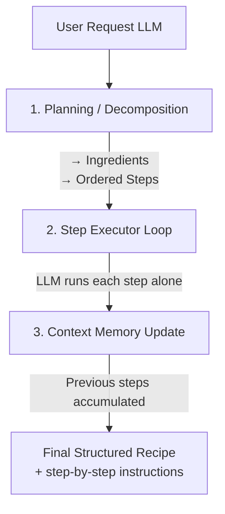

# LLM Recipe Generation Workflow

## Workflow Steps

1. **User Request (LLM)** - Initial user input requesting a recipe
2. **Planning / Decomposition** - LLM breaks down the request into:
   - Ingredients needed
   - Ordered steps to follow
3. **Step Executor Loop** - LLM processes each step individually
4. **Context Memory Update** - Previous steps are accumulated in memory
5. **Final Output** - Structured recipe with complete step-by-step instructions
